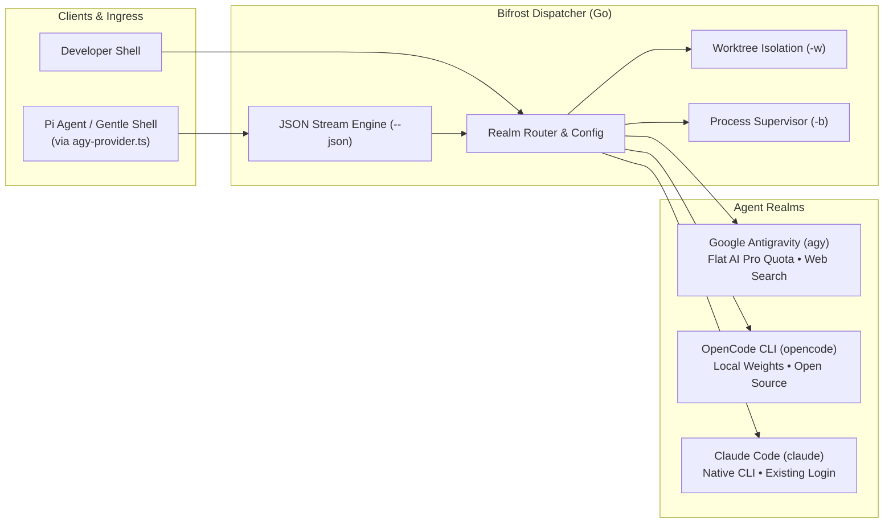

# bifrost

A fast, compiled Go CLI to route, dispatch, and isolate AI coding agents (`agy`, `opencode`, and native Claude Code) on your machine.

Inspired by Google AX's declarative workspaces, but built for local development: instead of running heavy cluster infrastructure, it uses native Git worktrees so background agents can refactor and test code without touching your active editor or uncommitted files.

[](https://github.com/FullFran/bifrost/actions/workflows/ci.yml)
[](https://github.com/FullFran/bifrost/releases)
[](LICENSE)

---

## Why this exists

1. **Context and token efficiency**: Running bulk refactoring or secondary reviews directly inside your primary interactive agent eats up the context window fast. Delegating self-contained tasks to an external CLI keeps the primary session lean.
2. **Workspace safety**: Running autonomous agents in your current directory while you are coding leads to dirty git states and race conditions. Bifrost isolates each task into an ephemeral git worktree on its own branch.
3. **Multi-agent flexibility**: Different tasks suit different tools. Google Antigravity (`agy`) gives you flat-rate Google AI Pro quota and grounded search; OpenCode (`opencode`) gives you local and open-source models. Bifrost provides a single interface with fallback routing across all of them.
4. **Subagent engine for Pi Coding Agent**: Acts as the backend execution bridge for Pi (`@earendil-works/pi-coding-agent`) and frontends like Gentle Shell, providing full agent capabilities (file tools, terminal commands, web search) packaged as native UI subagents with live thinking traces.

---

## How it works



- **Realms**: Drivers that know how to invoke each agent headless with proper permissions (`agy -p ... --dangerously-skip-permissions` or `opencode run --auto ...`).
- **Workspace Isolation (`-w`)**: Checks your git root and creates a temporary worktree (`bifrost/<task-id>`). The agent works there in isolation. You can review the diff and merge when ready.
- **Detached Execution (`-b`)**: Detaches the process cleanly, captures all stdout/stderr to disk, tracks PIDs, and lets you follow the logs live in another terminal.
- **JSON Streaming (`--json`)**: Streams line-delimited events on stdout for machine-to-machine integrations (e.g., Pi / Gentle Shell subagents).

---

## 📚 In-Depth Documentation

Complete architecture diagrams and technical guides are available in the [`docs/`](docs/README.md) directory:

- [**System Architecture & Design**](docs/architecture.md): Subsystems, C4 diagrams, and execution matrix.
- [**Pi Agent & Subagent Integration**](docs/pi-integration.md): End-to-end sequence diagrams, Pi provider mechanics, and thinking stream mapping.
- [**The Realms System**](docs/realms.md): Agent driver interface, model/effort reconciliation, and adding new backends.
- [**Worktrees & Process Supervisor**](docs/worktrees-and-supervisor.md): Ephemeral Git workspaces, state machines, and background process management.

---

## Install

### Quick install (recommended)

```bash
curl -fsSL https://raw.githubusercontent.com/FullFran/bifrost/main/scripts/install.sh | bash
```

### From source

```bash
git clone https://github.com/FullFran/bifrost.git
cd bifrost
make install
```

Verify your setup:

```bash
bifrost realms
```

---

## Usage

### 1. Basic dispatch

```bash
# Auto-route using configured priority (default: agy -> opencode -> claude)
bifrost "Audit internal/router for concurrency issues"

# Target a specific agent
bifrost -r agy "Write unit tests for the supervisor package"
bifrost -r opencode "Refactor this helper function"
bifrost -r claude "Review the parser"
```

### 2. Isolated execution (Git Worktree)

To prevent the agent from touching your current workspace or uncommitted changes:

```bash
bifrost -w "Refactor database migrations to support postgres 16"
```

When it finishes, review what changed:

```bash
bifrost diff <task-id>
bifrost merge <task-id>
```

### 3. Background jobs and live streaming

For long tasks (test generation, deep audits, large refactors):

```bash
# Launch detached in background with worktree isolation
bifrost -w -b "Generate full test coverage for internal/supervisor"
# => 🚀 Agent dispatched in background! Task ID: bf_20260923_150000_a1b2 (PID: 45210)

# Check active and completed tasks
bifrost list
bifrost status bf_20260923_150000_a1b2

# Stream output in real time from another terminal
bifrost logs -f bf_20260923_150000_a1b2

# Review and merge
bifrost diff bf_20260923_150000_a1b2
bifrost merge bf_20260923_150000_a1b2

# Or discard changes and delete the worktree
bifrost clean bf_20260923_150000_a1b2
```

### 4. Pi Coding Agent Subagents

Bifrost includes first-class support for driving native subagents in **Pi** (`@earendil-works/pi-coding-agent`) and frontends like **Gentle Shell**:

```bash
# Streams agent JSON events on stdout for extension consumption
bifrost --json -r agy -d /path/to/project -m gemini-3.8-flash-medium "Audit auth package"
```

In any Pi environment (such as Gentle Shell), simply invoke `@agy`:
```text
@agy "Refactor the caching layer in internal/store"
```
The subagent widget will appear in the UI, tool executions stream into the collapsible **Thinking** view, and token usage reflects Google AI Pro quota. See [Pi Integration](docs/pi-integration.md) for details.

---

## Configuration

Settings live in `~/.config/bifrost/config.json`:

```json
{
  "default_realm": "auto",
  "priority": [
    "agy",
    "opencode",
    "claude"
  ],
  "fallback_on_error": true,
  "worktree": {
    "auto_cleanup_on_merge": true
  },
  "realms": {
    "agy": {},
    "opencode": {},
    "claude": {}
  }
}
```

Realms carry no model or effort by default, so each agent uses its own current default and keeps tracking it as the agent ships new models. Pin one only when you want to:

```bash
bifrost models agy                         # see what agy can run
bifrost config set agy model gemini-4-argon-high
bifrost config set agy effort low
bifrost config unset agy model             # back to agy's own default
```

Inspect configuration or control any realm without editing JSON:

```bash
bifrost config                         # human-readable display and file location
bifrost config --json                  # JSON only; includes effective enabled/auto booleans
bifrost config set claude enabled false # block explicit AND automatic dispatch
bifrost config set claude enabled true
bifrost config set claude auto false    # explicit -r claude still allowed
bifrost config unset claude auto        # restore default true
bifrost doctor                         # installation availability and policy in separate columns
```

Both `enabled` and `auto` accept exactly `true` or `false`. Omitted controls default to `true`, including in existing config files. Existing priority lists are preserved; newly generated configs append Claude after agy and OpenCode. Automatic routing filters both the priority list and the registry fallback by these controls. Malformed configuration stops dispatch and config changes instead of silently enabling realms.

Claude is launched as the **native installed CLI**, using its existing login and settings. Bifrost does not read credentials, select a billing account, or guarantee subscription-only usage. Check your Claude Code account and extra-usage settings yourself before dispatch. All native Claude tasks use `--dangerously-skip-permissions -p`; only use this unattended mode in trusted workspaces. See [Claude realm details](docs/realms.md#23-valhalla-claude--native-claude-code).

---

## Command Reference

| Command / Flag | Description |
|---|---|
| `bifrost "<prompt>"` | Dispatches a task to an agent realm |
| `bifrost -r, --realm <REALM>` | Select target realm (`agy`, `opencode`, `claude`, or `auto`) |
| `bifrost -w, --worktree` | Isolate execution inside an ephemeral Git Worktree |
| `bifrost -b, --bg` | Run asynchronously in background (detached job) |
| `bifrost -m, --model <MODEL>`| Specify LLM model override |
| `bifrost -e, --effort <VAL>` | Reasoning effort level (`low`, `medium`, `high`) |
| `bifrost -d, --dir <DIR>` | Working directory (defaults to current directory) |
| `bifrost --json` | Stream agent JSON events on stdout (diagnostics to stderr) |
| `bifrost realms` | Doctor check: probes installed binaries and status |
| `bifrost models [REALM]` | List models available to a specific realm |
| `bifrost list` | Lists active and historical jobs |
| `bifrost status <id>` | Shows detailed task state, PID, and duration |
| `bifrost logs [-f] <id>` | Prints or streams (`-f`) execution logs |
| `bifrost diff <id>` | Shows git diff produced by a worktree task |
| `bifrost merge <id>` | Merges the isolated branch into your active branch |
| `bifrost clean <id>` | Removes worktree directory and temporary branch |
| `bifrost prune` | Cleans all finished jobs, logs, and orphan worktrees |
| `bifrost abort <id>` | Gracefully terminates a running background task |
| `bifrost config [--json]` | Shows configuration; `--json` emits effective policy without a banner |
| `bifrost config set/unset` | Sets or removes realm-specific `model`, `effort`, `enabled`, or `auto` |

---

## License

MIT
