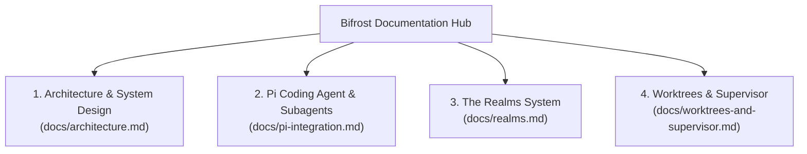

# Bifrost Documentation 📚

Welcome to the **Bifrost** technical documentation. This directory provides in-depth architectural guides, component references, and integration walkthroughs.

---

## 🗺️ Documentation Map

---

## 📖 Available Guides

| Guide | Description | Key Topics |
|---|---|---|
| [**Architecture & System Design**](architecture.md) | High-level system structure, subsystems, and execution matrix. | Core components, C4 container diagram, data flows, execution modes. |
| [**Pi Agent & Subagent Integration**](pi-integration.md) | How Bifrost acts as a subagent bridge for the Pi ecosystem (Gentle Shell). | Provider registration, tool streaming as thinking, token telemetry, abort signaling. |
| [**The Realms System**](realms.md) | Agent drivers (Asgard / agy & Midgard / opencode). | Realm interface, model/effort reconciliation, auto-fallback, adding new realms. |
| [**Worktrees & Process Supervisor**](worktrees-and-supervisor.md) | Ephemeral Git isolation and daemonless background execution. | Git worktrees, diff/merge/clean cycle, detached process management, log streaming. |

---

## 🚀 Quick Navigation

- Want to see how **Pi agents (like Gentle Shell)** run Antigravity as a native subagent? Check out [Pi Integration](pi-integration.md).
- Want to know how **ephemeral Git worktrees** protect your code? See [Worktrees & Supervisor](worktrees-and-supervisor.md).
- Want to add a **new agent CLI** (like Claude Code)? See [The Realms System](realms.md).
- Want an overview of the **compiled Go architecture**? See [Architecture & System Design](architecture.md).
