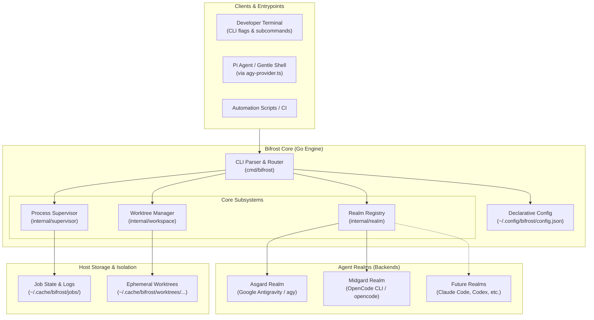
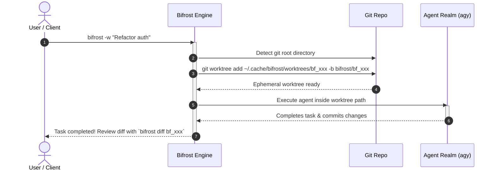

# Bifrost Architecture & System Design

Bifrost is a lightweight, compiled Go CLI designed to route, dispatch, and isolate autonomous AI coding agents (`agy`, `opencode`, and future backends) on local developer workstations.

---

## 1. High-Level Architecture

Bifrost acts as the orchestration layer between the user (or client interfaces like the Pi coding agent ecosystem and Gentle Shell) and underlying AI agent CLI runtimes. It abstracts execution mechanics, workspace isolation, background process lifecycle, and output formatting.



---

## 2. Core Subsystems

### 2.1. Realm Registry (`internal/realm`)
A Realm represents an agent backend driver. Each realm implements a uniform Go interface:

```go
type Realm interface {
    ID() string
    Name() string
    Description() string
    IsAvailable(ctx context.Context) (bool, string)
    BuildCommand(ctx context.Context, task Task, targetDir string) (*exec.Cmd, error)
    ModelsCommand(ctx context.Context) (*exec.Cmd, error)
}
```

* **Asgard (`agy`)**: Dispatches tasks to Google Antigravity. Operates under flat-rate Google AI Pro quota with web search grounding and deep reasoning. Manages `--dangerously-skip-permissions`, effort level suffixes (e.g., `gemini-3.8-flash-high`), and `--output-format stream-json`.
* **Midgard (`opencode`)**: Dispatches tasks to OpenCode CLI for local weights and open-source models.
* **Dynamic Resolution & Fallback**: If `-r auto` (default) is set, Bifrost queries the priority list defined in `config.json`. If the primary realm fails or is unavailable and `fallback_on_error` is true, Bifrost seamlessly tries the next available realm.

### 2.2. Workspace Isolation (`internal/workspace`)
Autonomous coding agents can modify files unexpectedly. To guarantee zero side-effects on your active working directory, Bifrost uses native Git worktrees:



1. **Isolation Creation**: Checks that the current directory belongs to a git repository. Creates an ephemeral worktree directory in `~/.cache/bifrost/worktrees/<task-id>` with a dedicated branch named `bifrost/<task-id>`.
2. **Execution**: The target agent's working directory is set to this worktree.
3. **Review & Merge**: The user inspects diffs (`bifrost diff <id>`) and merges the changes cleanly into their active branch (`bifrost merge <id>`) without git conflicts in their main tree.
4. **Cleanup**: Automated or explicit deletion of worktree directories and branches (`bifrost clean <id>` or `bifrost prune`).

### 2.3. Process Supervisor & Background Execution (`internal/supervisor`)
When running large refactors or test suites, tasks can take minutes. Bifrost provides daemonless process supervision:

* **Detached Execution (`-b`)**: Fork/execs the worker process detached from the current terminal session, persisting metadata in `~/.cache/bifrost/jobs/<id>.json`.
* **Standard Output & Error Capture**: Standard output and standard error are routed directly into `~/.cache/bifrost/jobs/<id>.log`.
* **Inspection & Live Streaming**:
  - `bifrost list`: Displays all active and historical jobs with status, duration, and PID.
  - `bifrost logs -f <id>`: Streams log output in real-time.
  - `bifrost abort <id>`: Sends a graceful termination signal (`SIGTERM` followed by `SIGKILL` if unresponsive) using OS-level process groups.

### 2.4. JSON Streaming Protocol (`--json`)
Designed for host environments and subagent extensions (such as Pi coding agent / Gentle Shell):
* When `--json` is supplied, Bifrost tells the agent to produce line-delimited streaming JSON events on `stdout`.
* All Bifrost internal logs, banner texts, and diagnostics are redirected to `stderr`.
* This creates a clean machine-readable pipeline where consumer applications parse live agent progress, tool calls, and token usage while remaining interactive.

---

## 3. Execution Matrix

Bifrost supports 4 execution modes based on flags:

| Mode | Command Example | Use Case |
|---|---|---|
| **Direct Foreground** | `bifrost "Fix lint errors"` | Quick synchronous edits directly in your current directory. |
| **Isolated Worktree** | `bifrost -w "Migrate DB schema"` | Synchronous edits in an ephemeral branch to protect your workspace. |
| **Detached Background** | `bifrost -w -b "Write unit tests for /pkg"` | Long-running tasks running in isolation while you keep working. |
| **Stream JSON (Subagent)** | `bifrost --json -r agy "<prompt>"` | Machine-to-machine streaming for Pi / Gentle Shell subagents. |
