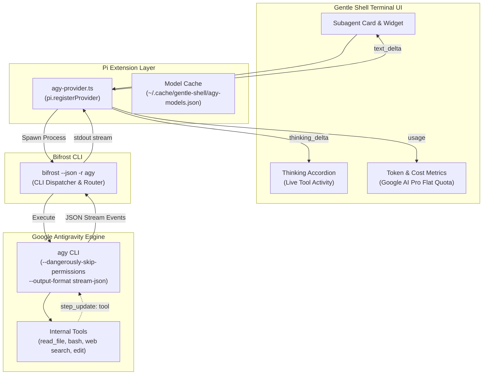
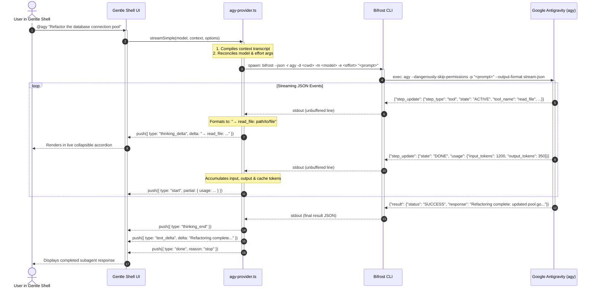

# Gentle Shell & Pi Subagent Integration

Bifrost powers native AI subagents inside **Gentle Shell** (the terminal AI coding assistant built on the Pi core: `@earendil-works/pi-coding-agent` and `@earendil-works/pi-ai`).

This bridge allows Gentle Shell to dispatch autonomous delegate tasks to **Google Antigravity (`agy`)** using flat-rate Google AI Pro quota, full tool access (file editing, terminal commands, web search), and deep reasoning models—all appearing seamlessly as a native subagent widget in the Gentle Shell UI.

---

## 1. How It Works (The Core Concept)

Gentle Shell typically communicates with raw LLM APIs (OpenAI, Anthropic, Gemini) via streaming text and tool calls executed by the shell itself.

However, **Google Antigravity (`agy`) is not a raw LLM—it is already a complete, autonomous agent** with its own execution environment, permission models, and native tools.

To bridge this without architectural friction:
1. **The Provider Illusion**: An extension (`agy-provider.ts`) registers `agy` as a Pi model provider (`pi.registerProvider("agy", ...)`).
2. **Subagent Definition**: An agent definition (`subagents/agy.md`) specifies `model: agy/default`. Gentle Shell treats `agy` as a native subagent with cards, background execution, and cancellation.
3. **Bifrost Translation**: When the subagent runs, Bifrost spawns `agy` in streaming JSON mode (`--output-format stream-json`).
4. **Tools as Thinking**: As `agy` uses its internal tools (e.g., reading files, running bash commands), Bifrost outputs JSON events that the extension intercepts and converts into Pi **"Thinking" deltas**. The user sees live tool execution directly inside the collapsible thinking accordion!
5. **Final Output Stream**: When `agy` finishes with status `SUCCESS`, its final answer is emitted as the subagent's response text.



---

## 2. End-to-End Sequence Diagram

The interaction lifecycle from prompt invocation to result rendering:



---

## 3. Key Components & Implementation Details

### 3.1. The Extension: `agy-provider.ts`

The extension resides in `~/.gentle-shell/agent/extensions/agy-provider.ts` and performs several key tasks:

1. **Model Discovery & Catalog Synchronization**:
   - Runs `bifrost models agy` in the background on startup.
   - Parses the tab-separated model ID and name list.
   - Caches available models to `~/.cache/gentle-shell/agy-models.json`.
   - Exposes them to the Gentle Shell model selector under provider `agy/`.

2. **Context Compilation (`buildPrompt`)**:
   - Gentle Shell sends the conversational history as an array of messages (`user`, `assistant`, `toolResult`).
   - If it's a follow-up conversation, the extension stitches previous turns into a clean markdown transcript:
     ```text
     Conversation so far:

     User: ...
     Assistant: ...

     Continue from the last user message.
     ```
   - This allows Antigravity to retain complete context across multiple turns without needing stateful API sessions.

3. **Tool Execution Mapping to Thinking**:
   - Standard LLM providers stream `reasoning` or `thinking` blocks.
   - Antigravity reports tool execution via JSON steps:
     ```json
     {
       "step_update": {
         "step_type": "tool",
         "state": "ACTIVE",
         "tool_name": "run_command",
         "tool_info": { "parameters": { "CommandLine": "go test ./..." } }
       }
     }
     ```
   - The provider converts this into readable thinking deltas:
     ```text
     → run_command: go test ./...
     ```
   - Any agent narration preceding the tool call is similarly emitted into the thinking stream.

4. **Lifecycle & Cancellation**:
   - If the user cancels the task in Gentle Shell (`Ctrl+C` or closing the widget), the `AbortSignal` listener fires:
     ```typescript
     const abort = () => child.kill("SIGTERM");
     options?.signal?.addEventListener("abort", abort, { once: true });
     ```
   - This sends `SIGTERM` directly to Bifrost, which cleans up and terminates the child `agy` process group cleanly.

---

### 3.2. Subagent Manifest: `subagents/agy.md`

Defined in `~/.gentle-shell/agent/subagents/agy.md`:

```markdown
---
name: agy
description: Google Antigravity (agy) as a subagent, dispatched through bifrost. Runs on the Google AI Pro flat quota with Gemini models and grounded web search. Use for bulk refactors, test generation, repository-wide exploration, web research, or a second-opinion review. It works directly in the current directory with its own tools and returns its final answer.
model: agy/default
---

You are a delegated worker run through the Google Antigravity CLI. Complete the task you are given end to end with your own tools, then reply with a concise report: what you did, the files you changed, and anything left open.
```

---

## 4. Why This Architecture Shines

| Challenge | Traditional Approach | Bifrost + Gentle Shell Solution |
|---|---|---|
| **API Costs** | Every subagent call consumes metered API credits (Anthropic/OpenAI). | Runs on **flat-rate Google AI Pro quota**, enabling heavy subagent delegation at zero marginal cost. |
| **Agent in an Agent** | Nested agents trigger conflicting tool execution cycles. | Tool execution happens inside Antigravity and streams outward as UI **thinking** traces. |
| **Context Window Pollution** | Long file reads and test logs fill up the primary conversation. | The subagent runs in an isolated process; only its final synthesis returns to the primary chat. |
| **Model Selection** | Hardcoded models or complex proxy routing. | Dynamic discovery via `bifrost models agy` with reasoning effort reconciliation (`low`, `medium`, `high`). |
