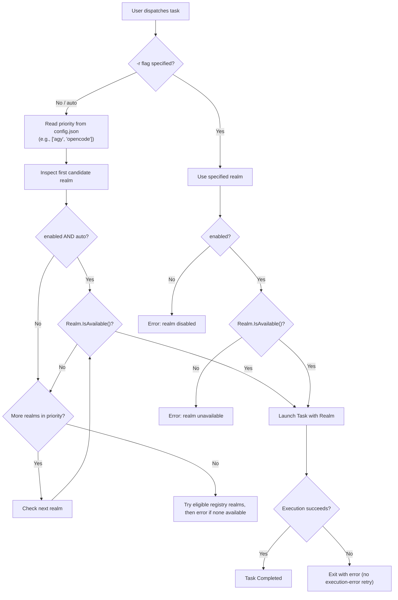

# The Realms System (Agent Drivers)

Bifrost uses the **Realms** pattern to decouple high-level orchestration (routing, worktrees, process supervision, streaming) from the concrete mechanics of each AI agent CLI.

---

## 1. The Realm Interface

Every agent supported by Bifrost implements the `Realm` interface defined in [`internal/realm/realm.go`](../internal/realm/realm.go):

```go
type Realm interface {
    ID() string
    Name() string
    Description() string
    IsAvailable(ctx context.Context) (bool, string)
    BuildCommand(ctx context.Context, task Task, targetDir string) (*exec.Cmd, error)
    ModelsCommand(ctx context.Context) (*exec.Cmd, error)
}
```

### Self-Registration
Realms register themselves during package initialization (`init()`):

```go
func init() {
    Register(&AsgardAgy{})
}
```

---

## 2. Supported Realms

### 2.1. Asgard (`agy`) — Google Antigravity
- **ID**: `agy`
- **Binary**: Looks for `agy` in `$PATH` or falls back to `~/.local/bin/agy`.
- **Capabilities**: Flat-rate Google AI Pro subscription, Gemini 3.8 / 4 series models, deep reasoning effort, grounded web search, and headless execution.
- **Flags Injected**:
  - `--dangerously-skip-permissions`: Runs unattended in headless/background mode.
  - `-p "<prompt>"`: The prompt string.
  - `--output-format stream-json`: Injected when `task.StreamJSON` is enabled (for `--json` / Pi extensions).
- **Model & Effort Reconciliation**:
  Antigravity encodes reasoning effort directly into model IDs (e.g. `gemini-3.8-flash-high`). If a user passes both `--model gemini-3.8-flash-high` and `--effort low`, `agy` would reject the command due to conflict. Bifrost intelligently inspects the suffix and swaps it to `gemini-3.8-flash-low`:
  ```go
  func agyModelArgs(model, effort string) []string {
      if model != "" {
          if base, ok := trimEffortSuffix(model); ok && effort != "" {
              return []string{"--model", base + "-" + effort}
          }
          ...
      }
  }
  ```

### 2.2. Midgard (`opencode`) — OpenCode CLI
- **ID**: `opencode`
- **Binary**: Looks for `opencode` in `$PATH` or `~/.local/bin/opencode`.
- **Capabilities**: Local weights, open-source models, Ollama/vLLM backends, custom provider endpoints.
- **Flags Injected**:
  - `run --auto`: Unattended autonomous mode.
  - `-m <model>`: When an explicit model override is provided.

### 2.3. Valhalla (`claude`) — Native Claude Code

- **ID / binary**: `claude`, discovered on `$PATH` or at executable `~/.local/bin/claude`.
- **Invocation**: `claude --dangerously-skip-permissions -p "<prompt>"`. Prompt and overrides are separate argv entries, not shell commands; the selected working directory is preserved.
- **Streaming**: `--json` adds `--output-format stream-json --verbose --include-partial-messages`. Native Claude events pass through unchanged; Bifrost diagnostics stay on stderr. Consumers must understand Claude's event schema, not assume agy's schema.
- **Model / effort**: optional `--model` and `--effort` pass through verbatim; CLI overrides win over realm config. With neither configured, Claude chooses its own defaults. No agy-style model-suffix rewriting applies.
- **Models**: Claude does not implement Bifrost's optional model-listing interface; `bifrost models claude` does not invoke an unsupported `claude models` command.
- **Authentication / usage**: Bifrost uses the native CLI's existing authentication, environment, and billing settings. It neither reads credentials nor forces subscription-only billing. Extra usage may incur charges depending on the user's Claude settings. No real-Claude billing experiment is part of this implementation.
- **Safety**: permission checks are bypassed for unattended execution, just as with agy. Use trusted directories and optional worktree isolation; a worktree is not a security sandbox.

---

## 3. Realm Resolution & Fallback Flow

When a user runs `bifrost "<prompt>"` without specifying `-r <realm>`, Bifrost invokes the resolution algorithm:



### Shared routing controls

```bash
bifrost config --json
bifrost config set claude enabled false
bifrost config set opencode auto false
bifrost config unset opencode auto
```

`enabled=false` blocks explicit dispatch and auto routing. `auto=false` only excludes automatic selection, including registry fallback. Omitted values mean `true` for backward compatibility. Boolean setters accept only lowercase `true` or `false`; unset restores the default. Machine-readable config exposes effective booleans for all registered realms alongside model/effort and priority. The human-readable `bifrost config` retains its file-location banner.

New configs prioritize `agy`, `opencode`, then `claude`; old priority lists are not rewritten. The historical registry fallback remains, but is policy-filtered. `fallback_on_error` remains a compatible stored setting; this dispatcher does **not** implement retry after an agent execution failure. Invalid JSON, wrong policy types, and null policies stop dispatch/config mutation; they never fall back to permissive defaults. Policy is checked when dispatch is requested; changing it does not cancel running jobs.

---

## 4. Realm Doctor & Model Inspection

You can inspect all configured realms and verify environment readiness using CLI commands:

### Check availability:
```bash
$ bifrost realms

REALM     NAME                          STATUS          ENABLED  AUTO   DETAILS
agy       Asgard (Google Antigravity)   ✅ Operational  true     true   /path/to/agy
opencode  Midgard (OpenCode)            ✅ Operational  true     false  /path/to/opencode
claude    Valhalla (Claude Code)        ✅ Operational  false    true   /path/to/claude
```

Availability means binary discovery, not authentication, account quota, or billing readiness. The `ENABLED` and `AUTO` columns describe policy independently of installation; disabled binaries may still be installed and reported operational.

### Inspect models supported by a realm:
```bash
$ bifrost models agy

gemini-3.8-flash-low      Gemini 3.8 Flash (Low Reasoning)
gemini-3.8-flash-medium   Gemini 3.8 Flash (Medium Reasoning)
gemini-3.8-flash-high     Gemini 3.8 Flash (High Reasoning)
gemini-4-argon-low        Gemini 4 Argon (Low Reasoning)
gemini-4-argon-high       Gemini 4 Argon (High Reasoning)
```

---

## 5. Adding a New Realm

To add a new backend (e.g. `Vanaheim / aider`):

1. Create a new file in `internal/realm/<name>.go`.
2. Implement the `Realm` interface:
   ```go
   package realm

   type ValhallaClaude struct{}

   func init() {
       Register(&ValhallaClaude{})
   }

   func (v *ValhallaClaude) ID() string { return "claude" }
   func (v *ValhallaClaude) Name() string { return "Valhalla (Claude Code)" }
   func (v *ValhallaClaude) Description() string { return "Anthropic Claude Code CLI" }
   ...
   ```
3. Register the binary path checks in `IsAvailable()`.
4. Build the execution command in `BuildCommand()`.
5. Run tests: `go test ./internal/realm/...`.
