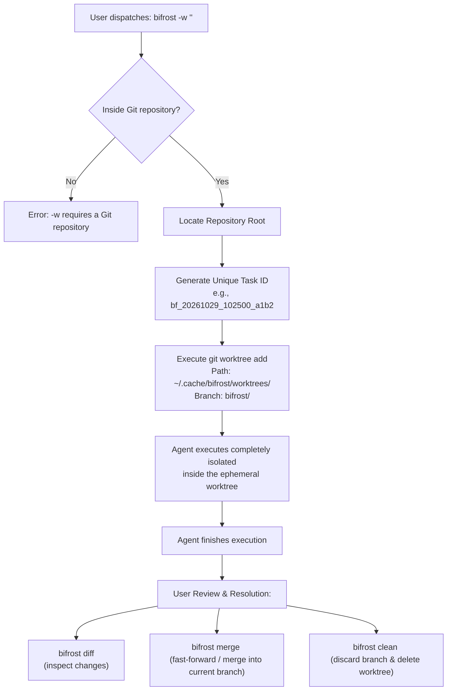
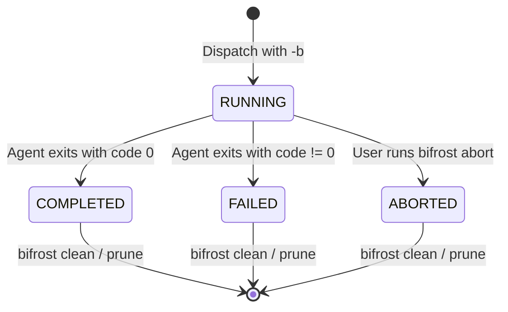

# Workspace Isolation & Process Supervisor

Bifrost solves two fundamental problems when running autonomous AI coding agents on local machines:
1. **Safety**: Preventing agents from modifying uncommitted code or creating git conflicts in your active editor.
2. **Asynchronous Execution**: Running tasks that take minutes without locking your shell or losing output.

---

## 1. Git Worktree Isolation (`-w`)

Autonomous agents frequently touch dozens of files, run formatting tools, and modify dependencies. Running this directly in your working directory while you code causes race conditions and dirty git states.

Instead of heavy VM or Docker containers, Bifrost uses **native Git Worktrees**:



### Worktree Workflow Commands

#### 1. Dispatching with isolation:
```bash
bifrost -w "Refactor user authentication to support OAuth2"
```

#### 2. Inspecting changes:
```bash
bifrost diff bf_20261029_102500_a1b2
```
This runs `git diff <parent-branch>...bifrost/<task-id>`, showing exact file diffs created by the agent.

#### 3. Merging back into your branch:
```bash
bifrost merge bf_20261029_102500_a1b2
```
Merges the isolated branch into your currently checked-out branch. If `worktree.auto_cleanup_on_merge` is set to `true` in `~/.config/bifrost/config.json`, the worktree directory and branch are automatically cleaned up.

#### 4. Discarding changes:
```bash
bifrost clean bf_20261029_102500_a1b2
```
Removes the worktree directory and deletes the temporary git branch.

---

## 2. Process Supervisor & Detached Jobs (`-b`)

When dealing with deep reasoning or repository-wide refactors, tasks often run for 2–10 minutes. Bifrost features a **daemonless process supervisor** that manages background jobs cleanly.



### Job Metadata Architecture

When a job is launched with `-b`:
1. **Metadata Persistence**: Bifrost records job metadata in `~/.cache/bifrost/jobs/<id>.json`:
   ```json
   {
     "id": "bf_20261029_102500_a1b2",
     "realm": "agy",
     "prompt": "Write unit tests for /internal/supervisor",
     "work_dir": "/home/user/projects/bifrost",
     "worktree_branch": "bifrost/bf_20261029_102500_a1b2",
     "worktree_path": "/home/user/.cache/bifrost/worktrees/bf_20261029_102500_a1b2",
     "pid": 38412,
     "status": "RUNNING",
     "created_at": "2026-10-29T10:25:00Z",
     "log_file": "/home/user/.cache/bifrost/jobs/bf_20261029_102500_a1b2.log"
   }
   ```
2. **Process Group Isolation**:
   The process is detached using OS-specific process attributes (`Setpgid: true` on Unix). This guarantees that closing your terminal does not kill the background agent, and `bifrost abort` can terminate the entire process tree without leaving orphan subprocesses.
3. **Log Capture**:
   All stdout and stderr streams are continuously written to `<id>.log`.

### Job Management Commands

#### Listing active and historical tasks:
```bash
$ bifrost list

ID                       REALM  STATUS     DURATION  PID    PROMPT
bf_20261029_102500_a1b2  agy    RUNNING    1m 12s    38412  Write unit tests for /internal/supervisor
bf_20261029_094012_98ff  agy    COMPLETED  3m 45s    31204  Audit concurrency in router
```

#### Detailed task status:
```bash
$ bifrost status bf_20261029_102500_a1b2
```

#### Live log streaming:
```bash
$ bifrost logs -f bf_20261029_102500_a1b2
```
Tails the log file in real time using unbuffered reads.

#### Terminating a running task:
```bash
$ bifrost abort bf_20261029_102500_a1b2
```
Sends `SIGTERM` to the process group. If the process does not terminate within 5 seconds, it escalates to `SIGKILL`.

#### Pruning old jobs:
```bash
$ bifrost prune
```
Removes all completed, failed, and aborted job records, logs, and any leftover orphan worktrees.
